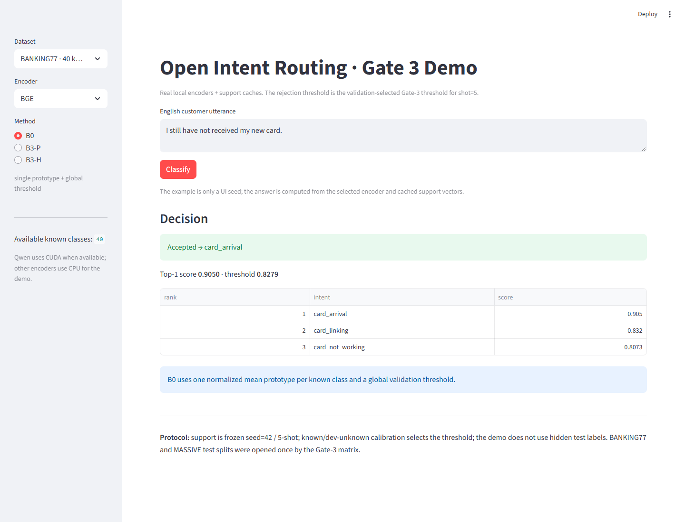
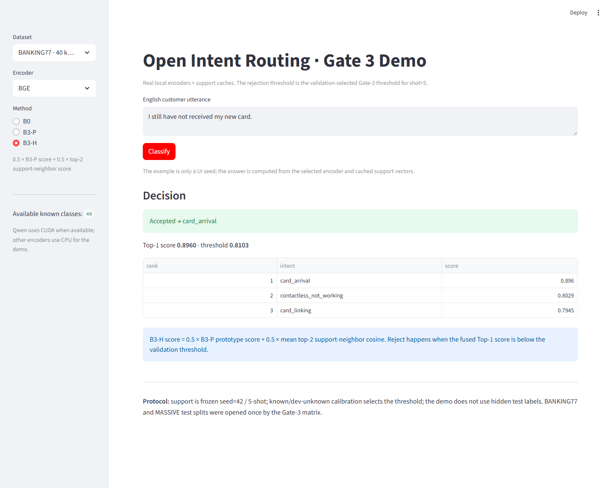

# Gate 3 Vibe Coding / 交互与修复记录

本文件记录 Gate 3 扩容期间的实际决策、代码迭代、失败与修复。所有截图均由
真实运行页面/文件生成，不使用合成图或伪造结果。

## 1. 用户目标

用户要求把 Gate 0–2 的 CLINC150 Pilot 扩展为：

- 3 个数据集：CLINC150（历史）、BANKING77、MASSIVE en-US；
- 4 个冻结编码器：BGE、Qwen、GTE-ModernBERT、E5；
- 5/10-shot；
- B0/B3-P/B3-H；
- BANKING77 上至少一个真正训练的少样本方法；
- 真实图表、Streamlit Demo、报告/PPT/演讲；
- 使用 `course-expansion` 分支提交，不覆盖 Gate 0/1/2。

## 2. 数据决策

### 2.1 BANKING77

- 77 类中按固定 SHA-256 选 40 known、18 dev、19 final；
- support 来自 train 每类 10 条（5-shot 为前 5）；
- calibration 从 train 中不重叠地取 20 条/类；
- known test 与 dev/final unknown 都来自官方 test 中互不重叠的类别；
- 原始标签是整数，通过 datasets-server 的 ClassLabel names 固定映射并保存
  `label_names.json`。

### 2.2 MASSIVE en-US

- 从 HF 仓库脚本指定的官方 1.1 tar.gz 下载，只解压 en-US JSONL；
- 60 类中按哈希选 35 known、12 dev、13 final；
- known 类要求 train≥10；否则 10-shot 无法满足；
- dev unknown 用官方 dev，final unknown 用官方 test；
- MASSIVE known 类覆盖 17/18 个 domain（未人为拉平）。

### 2.3 文本隔离

第一次生成 manifest 时发现：

- BANKING77 support 与 known test 有 1 条规范化重复；
- MASSIVE support/calibration 与 known test 有 1/5 条重复。

处理：

- support 候选先排除与所有 eval 文本重复的行；
- calibration 再排除与 support/test/unknown 重复的行；
- 重新生成 manifest 后所有 `text_overlap` 为 0；
- 官方 test 行没有删除或改写。

## 3. 代码结构与决策

- 新建 `src/gate3/`：prepare、encode、methods、run_matrix、freeze、aggregate、
  figures、train_setfit、train_adapter；
- `app.py`：真实模型 + 支持集缓存的 Streamlit Demo；
- `configs/gate3.yaml`：数据集、模型、阈值目标、训练对照设置；
- B3-H 固定 `w=0.5`，不把 0.5 包装成“调出来的创新”；
- 72 个阈值先 `gate3_freeze.json`，之后 test 只跑一次；
- SetFit 与投影适配器都保留，SetFit 是主训练对照；Adapter 是允许的补充
  训练尝试，不作为主创新。

## 4. 真实报错与修复

### 4.1 `PROJECT_ROOT` 少一层

`src/gate3/prepare.py` 初次运行时把 `src/` 当成项目根，报：

```text
FileNotFoundError: ...\src\data\manifest\selected_intents.json
```

修复：`Path(__file__).resolve().parents[2]`。

### 4.2 support CSV 字段不匹配

`finalize()` 第一次把带 `dataset/role/...` 的完整行写进只有 8 个字段的
support CSV，报 `ValueError: dict contains fields not in fieldnames`。
修复：为目标 CSV 显式投影字段。

### 4.3 Builder keyword-only 参数

BANKING/MASSIVE 的行使用位置参数，但 `Builder.add` 最初是 keyword-only，
报 `TypeError`。修复：改为普通参数，兼容位置和关键字调用。

### 4.4 SetFit 没有分类头

第一次训练完成后报：

```text
AttributeError: 'NoneType' object has no attribute 'fit'
```

原因：手工构造 `SetFitModel(model_body=...)` 时没有初始化 `model_head`。
修复：显式构造 `SetFitHead(in_features=384, out_features=40)`。

### 4.5 SetFit JSON 写入缺 fp

第二次训练完成后，训练指标已经算出，但写文件时报：

```text
TypeError: dump() missing 1 required positional argument: 'fp'
```

修复：`json.dump(payload, handle, ...)`。由于错误发生在写文件之前，第三次
重新训练 283.6 s，最终写出 `gate3_setfit_*`。这次失败也说明训练代价和
真实日志的价值：没有把中间指标伪造成最终文件。

### 4.6 Streamlit 安装改变 pandas

`streamlit==1.50.0` 要求 `pandas<3`，venv 中 pandas 从 3.0.2 变为 2.3.3；
已更新 `requirements.txt` / `requirements_lock.txt`。这是依赖降级，但没有
改写旧结果；旧 Gate 1/2 结果保持文件原样。

### 4.7 截图认证

DSH Web GUI 的没有会话 token 的本地页面返回 “authentication required”，
无法截图对话页。没有伪造聊天截图；改为提供两张真实 Streamlit 运行截图、
真实日志和真实提交记录。

### 4.8 图表标题截断

BANKING77 confusion 标题过长被截断；改为更短标题并降低字号，重新生成
图表。

## 5. 真实运行证据

- `logs/gate3_prepare.log`：3 数据集 manifest；
- `logs/gate3_encode_bge.log` / `qwen` / `gte` / `e5`：编码与显存；
- `logs/gate3_validation.log`、`gate3_freeze.log`、`gate3_test.log`：72 格；
- `logs/gate3_setfit.log`：283.6 s 训练与测试；
- `logs/gate3_adapter.log`：150 epoch 投影适配器；
- `logs/gate3_figures.log`；`logs/gate3_all_tests.log`：29 tests OK；
- `figures/gate3_streamlit_demo.png`：B0 真实浏览器截图；
- `figures/gate3_streamlit_b3h.png`：切换到 B3-H 并点击 Classify 后的真实截图。





## 6. 未做与边界

- 没有多 seed 方差；
- 没有新的独立 hard-OOS test；
- 没有可靠的 near/far domain 统一定义，因此该图 **NOT RUN**；
- 没有对 MASSIVE 的阈值目标做 test 后调参；
- 没有上传模型权重、嵌入 npz、venv、checkpoints、token；
- 没有把 SetFit/Adapter 的 test 复用写成盲测。
