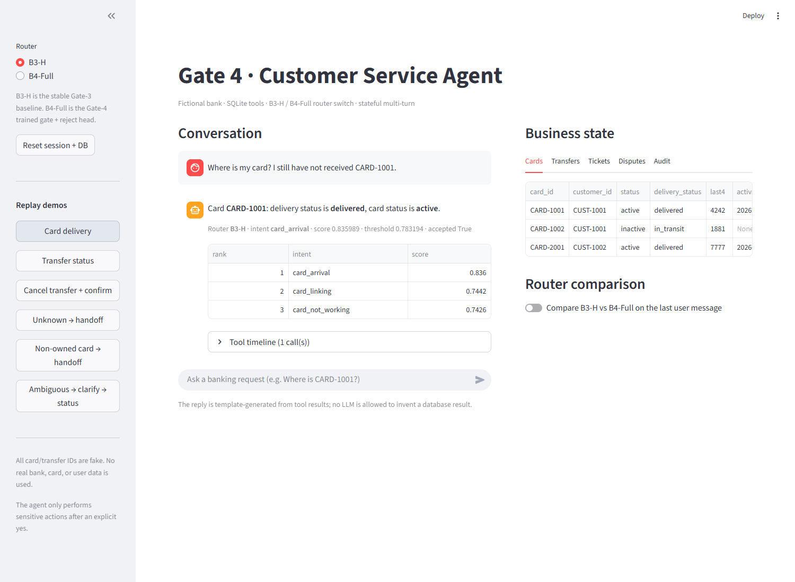
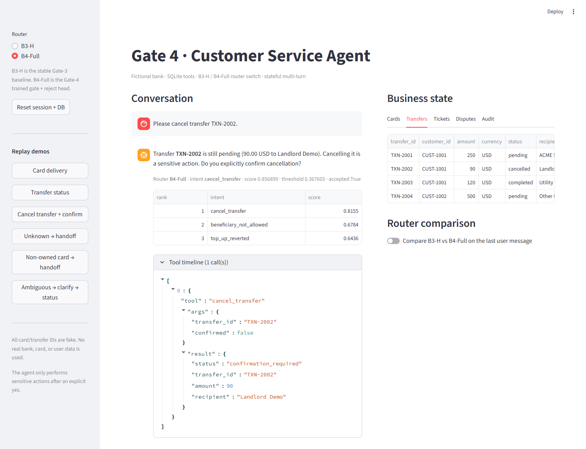

# Gate 4 Vibe Coding 记录

## 1. 用户目标

在 `course-expansion@1d78dd9` 基础上新建 `gate4-train-agent` 分支，完成：

- GTE / BANKING77 10-shot 的 B4-AR 可训练门控 + 拒识头；
- B0/B3-H/B4-Fusion/B4-Full 同 validation 对照，冻结后一次 test；
- SQLite 真实业务库、有状态多轮 Agent、审计工具调用；
- Streamlit 聊天 + 右侧业务面板 + B3-H/B4 切换；
- 4 个以上端到端剧本、15 条以上脚本化测试、真实截图；
- 代码、日志、CSV/JSON、图表、报告、PPT 大纲、讲稿、Vibe 记录提交推送。

## 2. 实际决策

- B4 不改编码器，只训练 4→32→1 门控和 7→16→1 拒识头；
- 训练只用 400 条 support；每类 5 条原型、5 条 query；两折互换；
- 每 episode 屏蔽 6/40 类，屏蔽类 query 作为 pseudo-OOS；
- calibration/dev 只用于验证和阈值，不进入梯度；
- B4 test 在 checkpoint/阈值 freeze 后只跑一次；明确标注 test 已看过；
- Agent 使用显式状态机 + SQLite，不引入 LangGraph/LLM，避免框架耗时；
- 16 条 StubRouter 状态/工具测试与 6 条真实路由演示分开报告，不用前者冒充模型泛化。

## 3. 真实错误与修复

### 3.1 B4 门控 shape

第一次训练报：

```text
RuntimeError: Sizes of tensors must match except in dimension 2.
Expected size 170 but got size 1 for tensor number 3
```

原因：`dmat = d.view(1,c,1).expand(-1,c,1)` 只扩展了 1 行。
修复：`expand(p.shape[0], c, 1)`。

### 3.2 validation CE 形状不匹配

`eval_gate` 最初把 2,123 行 validation 分数和 800 行 known 标签直接算 CE，
会在运行时报 shape 错。修复：只对 `known_mask` 的 800 行算 known CE；
B4-Full 的 reject BCE 使用完整 2,123 行 `y_all`。

### 3.3 代码里的占位 import

`train_b4.py` 一度写入不可执行的占位 import：

```python
B4_PROMPT_placeholder if False else B4AR
```

编译前发现并删除，最终只 import `B4AR` 和 `b4_core`。

### 3.4 HF token 过期

本机缓存的 GTE 能离线加载，但 `SentenceTransformer` 仍尝试访问 Hub，报
401 / `OAuth token has expired`。修复：`local_files_only=True`。没有把 token
写进仓库。

### 3.5 SQLite reset 被 Windows 锁住

Streamlit 点击 Demo 时：

```text
PermissionError: [WinError 32] 另一个程序正在使用此文件，进程无法访问
```

原因：`seed(reset=True)` 直接 `unlink` 正在被旧连接使用的 db。
修复：不再删文件，改为在现有连接上 `DROP TABLE` 后重建；并在切换 session
前关闭旧 `BankingTools` 连接。

### 3.6 Agent case 的工具字段

`run_agent_cases.py` 第一次把 `turn.tools` 存成工具名列表，后面按 dict 读取，
报 `TypeError: string indices must be integers`。修复：保存完整 tool dict。

### 3.7 B4 案例 known_correct 选错

最初 `known_correct` 条件用 `pred == classes[class_u]`，而 `class_u` 就是
argmax，所以任何 accepted 样本都会“正确”。修复为：

```python
pred != OOS and pred == classes[true_idx]
```

test 已经跑过，没有重新加载模型；用已保存的 predictions 重新选择 5 个案例，
并保存 `gate4_b4_test_cases.csv`。这是一次 case 生成修复，不是 test 重跑。

### 3.8 截图等待

第一次 Playwright 等 `delivery status` 超时，原因是 Streamlit 点击后
`new_session` 里 SQLite 文件被锁，页面显示异常。修复 DB reset 后重新截图；
没有使用合成图。

## 4. 真实验证

- `logs/gate4_train_b4.log`：24 episodes，60+60 epochs，12.55 s；
- `logs/gate4_freeze_b4.log`：fusion/full checkpoint SHA；
- `logs/gate4_test_b4.log`：一次探索性 test；
- `logs/gate4_agent_cases.log`：16/16 确定性 case + 6/6 真实 demo；
- `logs/gate4_all_tests.log`：39 tests OK；
- `figures/gate4_agent_card.png`：B3-H 查卡；
- `figures/gate4_agent_b4_cancel.png`：B4-Full 取消转账，Transfers 显示
  cancelled，Tool timeline 展开 confirmation。





## 5. 没有做的事

- 没有伪造模型提升；
- 没有在 test 上重跑 B4；
- 没有把 16 条 StubRouter 测试写成真实模型泛化；
- 没有上传大模型权重、缓存、venv、API key、真实用户数据；
- 没有接真实银行或真实 LLM；
- 没有把 B4-Fusion 的退化藏起来。

## 6. 复现命令

```powershell
cd D:\code\intent-open-set
$env:HF_HOME = "D:\code\intent-open-set\data\model_cache"
.\.venv\Scripts\python.exe -m src.gate4.train_b4
.\.venv\Scripts\python.exe -m src.gate4.freeze_b4
.\.venv\Scripts\python.exe -m src.gate4.run_b4_test
.\.venv\Scripts\python.exe -m src.gate4.run_agent_cases
.\.venv\Scripts\python.exe -m src.gate4.make_figures
.\.venv\Scripts\python.exe -m unittest discover -s tests -v
.\.venv\Scripts\python.exe -m streamlit run app_gate4.py
```
