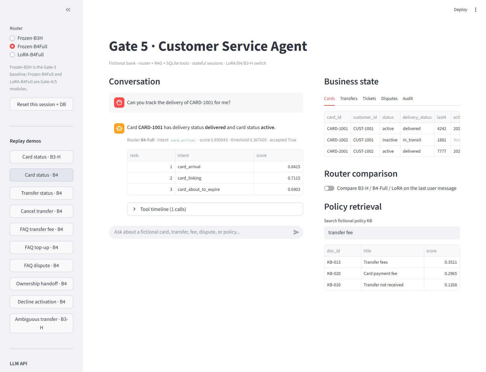
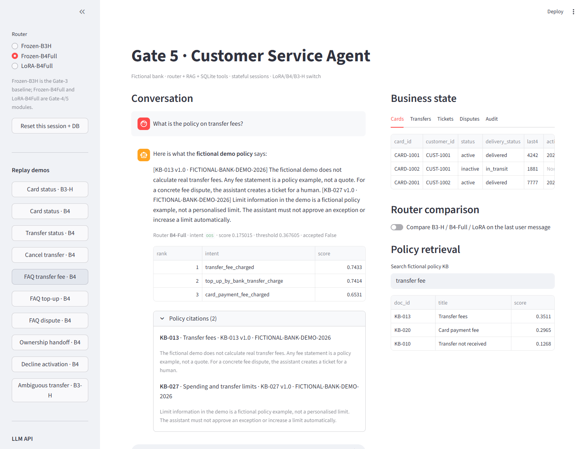
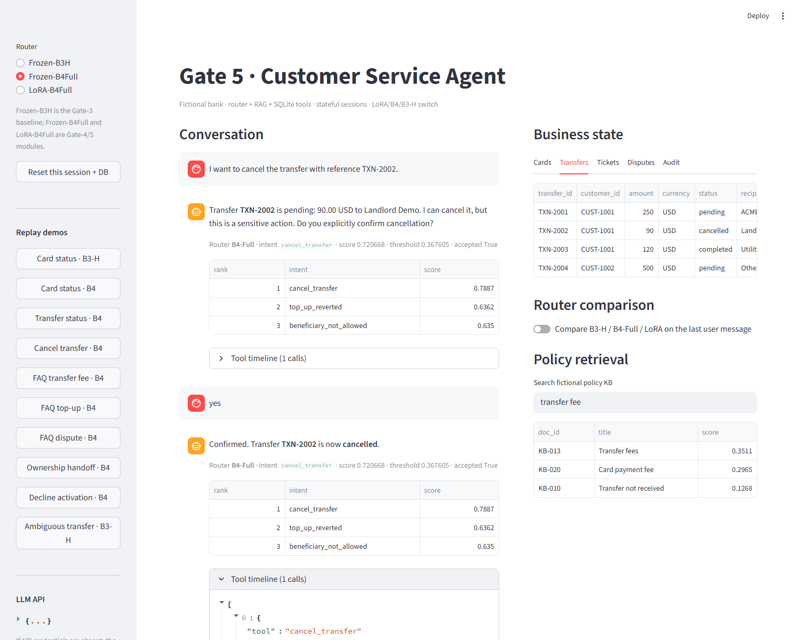

# Gate 5 Vibe Coding / 真实交互与修复记录

## 1. 用户目标

在 `gate4-train-agent@81e81a9` 上新建 `gate5-lora-agent`，实际完成：

- A：LoRA-GTE 真实训练、保存/重载、重编码与 B0/B3-H 对照；
- B：B4-RejectOnly 与 Frozen/LoRA × B3-H/RejectOnly/B4-Full 六组矩阵；
- C：25+ 虚构银行政策、RAG 引用、自然语言 Agent、SQLite 会话隔离、LLM 接口；
- D：≥120 条自然语言业务任务、3 个真实路由版本、端到端评测。

不覆盖 Gate0–4 冻结结果，不上传密钥/大权重/真实用户数据。

## 2. 实际决策

- LoRA 不做全量微调，只注入 `Wqkv/Wo/Wi`；
- 第一次 4 epoch 退化后，依据 **validation** 改成 2 epoch；test 未参与选择；
- B4-RejectOnly 的 gate 参数显式 `requires_grad=False`，固定 `g=0.5`；
- 120 条 benchmark 生成后先冻结 SHA，再跑三个真实 router；
- Agent 不引入 LangGraph/LLM 依赖，使用显式状态机 + SQLite；
- API 无凭据，明确写 `NOT RUN_API_BLOCKED`，不伪造调用。

## 3. 真实错误与修复

### 3.1 PEFT 与 transformers 5.23 不兼容

先安装 `peft==0.17.1`，导入时报：

```text
ImportError: cannot import name 'HybridCache' from 'transformers'
```

原因：PEFT 0.17.1 依赖旧版 transformers 的 cache API。没有降级 CUDA torch，
改为安装 `peft==0.21.3`，可正常导入并注入 LoRA。

### 3.2 门控 `dmat` 广播错误

训练第一次报：

```text
RuntimeError: Sizes of tensors must match except in dimension 2.
Expected size 170 but got size 1 for tensor number 3
```

原因：`d.view(1,c,1).expand(-1,c,1)` 只扩展了 1 行。修复为
`expand(p.shape[0], c, 1)`。

### 3.3 validation CE 形状

`eval_gate` 最初直接把 2,123 行 validation 分数和 800 行 known 标签算 CE，
会 shape 错。修复为只对 `known_mask` 的 800 行算 known CE；B4-Full 的
reject BCE 使用 2,123 行 `y_all`。

### 3.4 HF token 过期与 adapter 探测

模型已缓存，但 PEFT 安装后 `AutoModel.from_pretrained` 会探测
`adapter_config.json`，即使 `local_files_only=True` 也可能访问 Hub，报 401 /
OAuth token expired。

修复：
- 在入口最前面设置 `HF_HUB_OFFLINE=1`；
- 用直接 `AutoModel + CLS` 的 `FrozenEncoder` 代替 `SentenceTransformer`，
  避开 adapter 探测；
- 密钥从未写入仓库或日志。

### 3.5 LoRA 第一次 4 epoch 退化

4 epoch 的 validation B3-H F1 只有 0.7397，低于 frozen 0.7670；向量 shift
过大。根据 validation 改成 2 epoch，B3-H 回到 0.7605，B0 0.7531。4 epoch
指标保存在 `results/gate5_lora_4ep/`，adapter 未保留、未进入矩阵。

### 3.6 120 条 benchmark 的 turns 生成 bug

第一次生成 benchmark 时，少数 `add(..., "某句")` 传入字符串而不是列表，导致
`turns` 被逐字符迭代，出现 46 个“轮次”；那次运行结果无效，已丢弃。

修复：
- `add()` 中统一 `if isinstance(turns, str): turns=[turns]`；
- 重新生成 120 条，确认全部 `turns` 是 list；
- 重新冻结 SHA `2d3f157bf6ebc1f711430523b8b99510f7558c96db799a093d92262ac5c57f43`；
- 正式结果来自修复版任务集，没有修改任务内容去迎合模型。

### 3.7 SQLite 跨线程错误

Streamlit 切换 demo 时：

```text
ProgrammingError: SQLite objects created in a thread can only be used in that same thread.
```

修复：`sqlite3.connect(..., check_same_thread=False)`；每个 session 仍是独立
DB 文件，工具层所有权/确认不变。

### 3.8 Streamlit 路由选择被清空

Demo 按钮切换 B4 后，页面又回到 B3H，对话为空。原因是 demo 直接改 radio
key，触发 `st.session_state.router_choice cannot be modified after widget`。
修复：demo 先写 `pending_method`，下一次 rerun 在 radio 实例化之前把它写入
`router_choice`。

### 3.9 API 凭据缺失

`OPENAI_BASE_URL / OPENAI_API_KEY / OPENAI_MODEL` 均未设置。`LLMClient`
可用但不可调用；`gate5_llm_api_results.json` 明确记录
`NOT RUN_API_BLOCKED`，n_completed=0，没有伪造 12 条 API 会话。

## 4. 真实运行证据

- `logs/gate5_lora_train.log`：2 epoch，22.19 s，峰值 1368 MiB；
- `logs/gate5_lora_train_2ep.log`：4 epoch 与 2 epoch 对照；
- `logs/gate5_lora_encode.log`：4,280 条重编码，18.53 s；
- `logs/gate5_reject_frozen.log` / `gate5_reject_lora.log`：RejectOnly；
- `logs/gate5_b4_lora_train.log`：LoRA B4-Full；
- `logs/gate5_method_val.log` / `gate5_method_test.log`：9 行矩阵与一次历史 test；
- `logs/gate5_agent_demos.log`：10 条真实模型演示；
- `logs/gate5_benchmark.log`：360 条真实路由 benchmark；
- `logs/gate5_llm_api.log`：API 阻塞；
- `logs/gate5_all_tests.log`：48 tests OK；
- 三张真实截图：







## 5. 未做与边界

- 没有新的独立 BANKING77 盲测；test 是历史探索性；
- 没有多 seed LoRA、显著性检验；
- 没有 12 条真实 LLM API 调用（无凭据）；
- 没有真实银行/真实用户数据；
- 没有上传基座权重、embedding npz、venv、API key；
- 没有把 Stub 测试计入 120 条真实路由 benchmark；
- 没有修改冻结 benchmark 的期望去提高某个 router 的分数。
