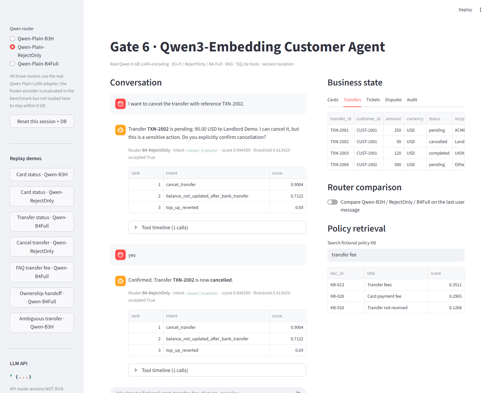
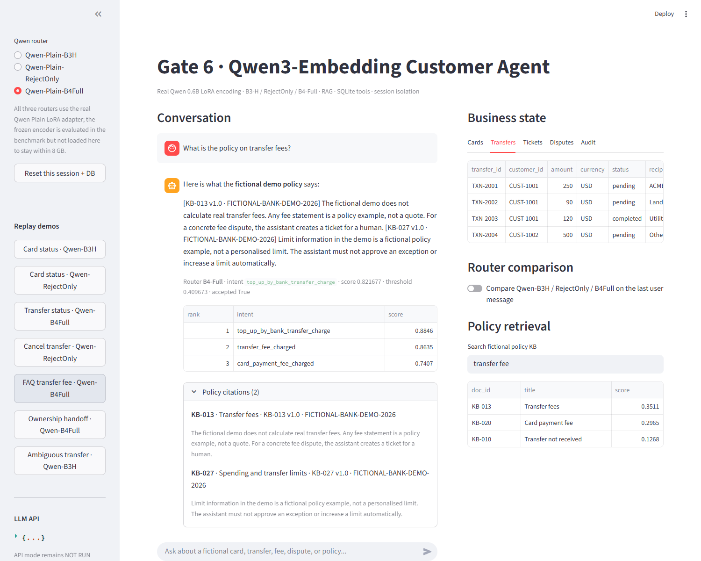
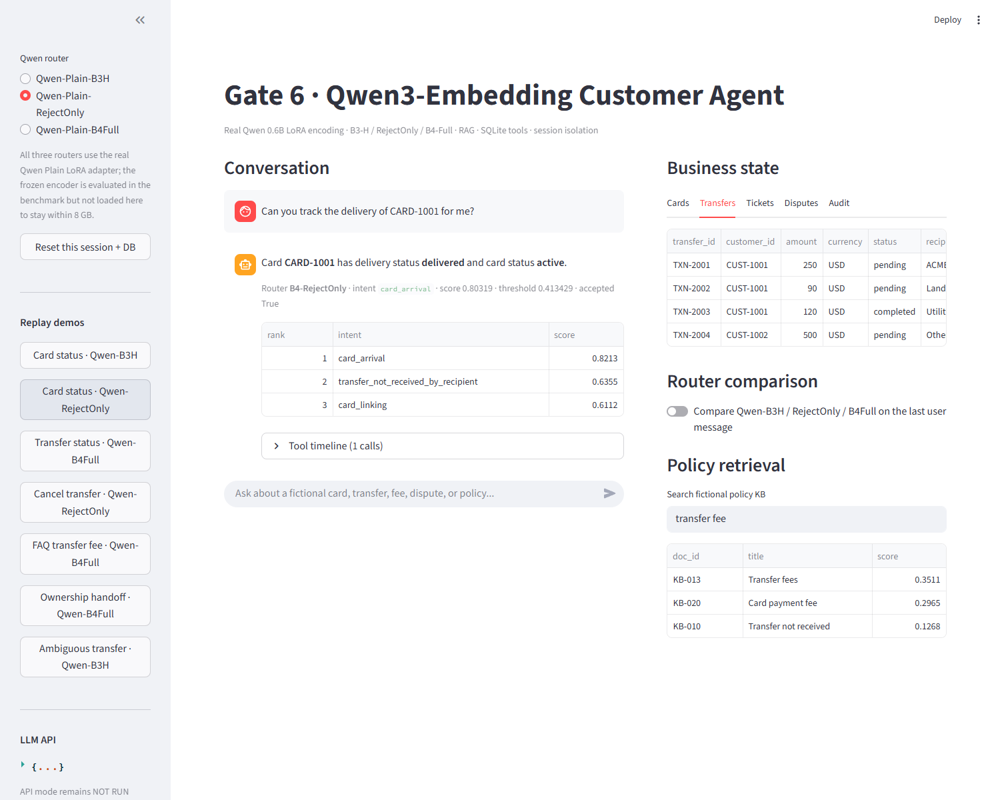

# Gate 6 Vibe Coding / 真实修复记录

## 1. 实际执行与结果

- 分支：`gate6-qwen-lora`，基线 `gate5-lora-agent@ba7c43f`；
- Qwen3-Embedding-0.6B，revision `97b0c614...`；
- A：冻结对齐 + LoRA smoke；
- B：Plain / Anchor 两次真实 LoRA 训练；
- C：Qwen Frozen/Plain × B4 全矩阵 + 一次历史 test；
- D：Qwen Agent 接入、6 条真实回放、120 任务 × 4 路由回归；
- 55 个 unittest 通过。

## 2. 真实错误与修复

### 2.1 Qwen left padding 对齐失败

第一次直接 encoder 用 left padding + 最后一个非 pad token，32 样本和 Gate3
cache 的 mean cosine 0.412，top1 0.344。原因：Gate3 SentenceTransformer 的
Qwen tokenizer 使用 **right padding**，Qwen causal/RoPE 的位置处理与 left
padding 不同。

修复：right padding + last non-pad token。对齐后 mean 0.999998，min
0.999995，top1 1.0；Gate3 B3H validation F1 0.74140 复现。

这是本轮最重要的工程修正：**没有对齐就不许训练。**

### 2.2 PEFT 探测 adapter_config 触发过期 HF token

训练和 router smoke 已通过，但 `benchmark_qwen`/`run_qwen_demos` 在导入
`transformers` 之后才导入 `qwen_encoder`，`HF_HUB_OFFLINE` 设置太晚，
`AutoModel.from_pretrained` 仍探测
`Qwen/Qwen3-Embedding-0.6B/.../adapter_config.json`，得到 401。

修复：

- 在入口脚本**所有 import 之前**设置 `HF_HUB_OFFLINE=1`、
  `TRANSFORMERS_OFFLINE=1`；
- `router_qwen.py` 顶部同样设置；
- 先做 `local_files_only=True` 加载，不依赖网络。

日志：`logs/gate6_qwen_benchmark.log`（失败版保留）。

### 2.3 Windows 页文件 `OSError 1455`

在同一进程里先加载 Qwen frozen 再加载 Qwen LoRA，第二个 `safetensors` 映射
时报：

```text
OSError: 页面文件太小，无法完成操作 (os error 1455)
```

这不是 CUDA OOM；是 Windows page file/地址空间问题。尝试过：

- 删除训练模型、`gc.collect()`、`torch.cuda.empty_cache()`；
- 单进程顺序跑 frozen→plain 仍失败。

最终修复：**benchmark 每个 router 单独一个 Python 进程**，各自写 partial
CSV，最后 `combine_qwen_benchmark.py` 合并。4 个进程都成功；GPU 峰值约
1.3GB。

### 2.4 smoke reload 时第二个 base 加载失败

`train_qwen_lora.py` 训练完 2 步后在同一进程里加载第二个 base 做 reload
验证，触发同样的 page file 错误。修复：先 `del model, base`，
`gc.collect()`，`torch.cuda.empty_cache()`，再加载 reload。

### 2.5 Qwen Qwen3ForCausalLM vs AutoModel

Qwen3-Embedding 的 config `architectures=Qwen3ForCausalLM`，但
`AutoModel` 实际加载 base `Qwen3Model`，输出 `last_hidden_state`；没有用
`AutoModelForCausalLM` 的 LM head。这样和 Gate3 的 SentenceTransformer
feature-extraction 路径一致。

### 2.6 训练 loss 正常但 validation/test 分叉

Plain/Anchor 的 validation 都高于 frozen，但 test 低于 frozen。没有据此
改 test 或挑 test 结果；在报告中作为负结果保留。4-epoch/多 seed 未做。

### 2.7 Qwen Agent 的 clarification=0

120 条中 5 条应澄清，Qwen 四个路由全部没有澄清。这是真实的 Agent 缺陷；
没有在评测后改规则。报告中明确写 0.0，而不是把“直接回答”算成澄清成功。

## 3. 真实资源与日志

- `logs/gate6_qwen_alignment.log`：32 样本对齐、B3H 复跑；
- `logs/gate6_qwen_pool_debug.log`：left/right padding 对照；
- `logs/gate6_qwen_plain_train.log`：295.2 s / 50 steps / 1,259.9 MiB；
- `logs/gate6_qwen_anchor_train.log`：290.2 s / 50 steps；
- `logs/gate6_qwen_plain_encode.log` / `anchor_encode.log`：4,280 条；
- `logs/gate6_qwen_*_reject.log` / `full.log`：B4 训练；
- `logs/gate6_qwen_matrix.log`：validation + 一次 test；
- `logs/gate6_qwen_benchmark_*.log`：4 个隔离进程；
- `logs/gate6_qwen_benchmark_combine.log`：480 行合并；
- `logs/gate6_qwen_demos.log`：6 条真实回放；
- `logs/gate6_all_tests.log`：55 tests OK；
- `logs/gate6_qwen_screenshots.log`：浏览器截图。

## 4. 真实截图







## 5. 未做 / 边界

- 没有新的独立 BANKING77 盲测；test 是历史探索性；
- 没有多 seed / 显著性检验；
- Anchor 只扫描 λ=0.5；
- 120 条任务已用于 Gate5 系统修复，本轮只做回归；
- LLM API 无凭据，`NOT RUN_API_BLOCKED`；
- 没有上传 base weights、embedding NPZ、venv、密钥；
- 没有把 per-router partial 结果伪造成一次性全进程运行。
