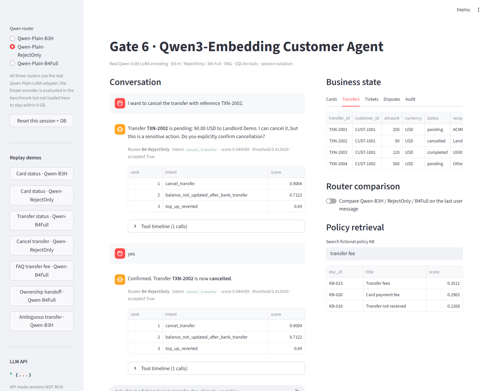
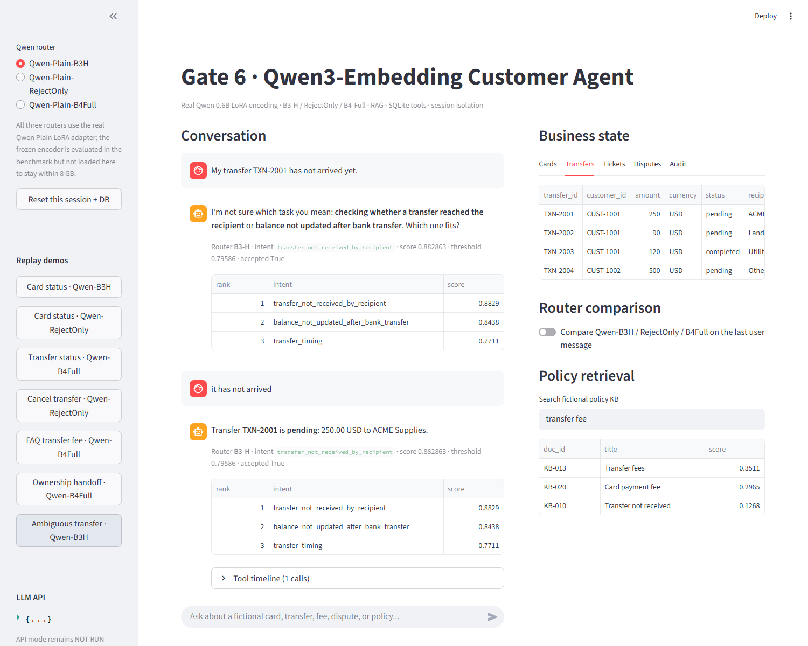

# Gate 7 Vibe Coding / 真实修复记录

## 1. 实际阶段

- A：双层 dev 冻结、6×6 vs 48×48、hard-negative 诊断、4 张图；
- B：P1/P2 真实训练、3-seed Plain 真实训练、P3 失败记录；
- C：3-seed dev 选择、冻结、一次历史 test；
- D：GTE/Qwen Agent 回归、澄清 bug 修复、稳定性 B4。

## 2. 真实错误

### 2.1 left padding 与 Qwen 对齐

沿用 Gate6 的 right padding 结论，本轮没有重复 left/right 训练；但把
Gate6 的 `0.999998` 对齐和 B3H replay 作为 A 的门槛。

### 2.2 `microbatch=2` 真实 6×6

原实现 `supcon_loss(z[6], y[6])`；`grad_accum=8` 只累积梯度，不合并 logits。
toy 文件 `results/gate7_toy_batch.json` 证明 6×6，48×48 只是假设。

### 2.3 P3 在 Windows 内存压力下停顿

P3（去掉 triplet，lr 1e-4）在 epoch2 到 step 40/50 时长时间停顿；GPU 1.5GB，
CPU 持续占用，最终停止并记录：

- `results/gate7_p3_incomplete.json`
- `logs/gate7_qwen_p3_train.log`

**没有 P3 adapter，不把它算成完成，也没有用 P3 的结果选任何东西。**

### 2.4 稳定性/Agent 并发导致 CUDA unknown error

先跑稳定性 B4，同时启动 Qwen Agent，出现：

```text
torch.AcceleratorError: CUDA error: unknown error
```

这是并发/内存压力下的 CUDA 运行时错误；停止稳定性进程、释放 Python 进程后，
把 Agent 改为串行重跑成功。失败的日志保留在
`logs/gate7_agent_qwen_frozen.log` 旧版本。

### 2.5 稳定性中断后结果丢失

`stability_b4` 只在最后写 CSV；进程被停止后没有 CSV。日志是 UTF-16，

```text
parse_stability.py: KeyError 'encoder'
```

原因是用 UTF-8 读 PowerShell `Tee-Object` 的 UTF-16 日志。修复：先尝试 UTF-8，
没有 JSON 时用 UTF-16 重新读取，并按 JSON 行恢复已完成的 36 行（GTE Frozen、
GTE-LoRA 42/43/44、Qwen Frozen、Qwen Plain42 的已完成部分）。没有伪造未完成
seed 的结果。

### 2.6 5 条应澄清任务

Gate6 中 B106–B110 均直接接受。Gate7 加通用语义守卫：

- accepted intent 属于 transfer-not-arrived 类；
- 文本出现 “not arrived / not received / not shown”；
- 先自然语言澄清，保留 TXN；
- 用户回答 “it has not arrived” 时选择 transfer status，不直接 handoff。

截图：`figures/gate7_agent_clarification.png`。
新测试：`test_transfer_ambiguity_guard`。

### 2.7 测试临时 SQLite 跨线程/句柄

测试在 `TemporaryDirectory` 清理时数据库仍打开，出现
`PermissionError WinError 32`。修复：在 `finally` 中关闭 agent，再退出临时目录。

### 2.8 GTE 训练路径参数化

为训练 GTE-LoRA seed43/44，给 Gate5 trainer 增加 `--tag`，输出
`gate7_gte43_adapter` / `gate7_gte44_adapter`，不覆盖 Gate5 adapter。
`encode_lora.py` 增加 `--training`/`--tag`；编译错误来自 PowerShell 把 `\n`
写成字面量，已修复。

## 3. 真实日志

- `logs/gate7_dev_split.log`
- `logs/gate7_diagnosis.log`
- `logs/gate7_qwen_p1_train.log` / `p2_train.log` / `p3_train.log`
- `logs/gate7_qwen_plain43_train.log` / `plain44_train.log`
- `logs/gate7_gte43_train.log` / `gte44_train.log`
- `logs/gate7_final_test.log`
- `logs/gate7_stability_all.log` / `gate7_stability_parse.log`
- `logs/gate7_agent_gte_reject.log` / `agent_qwen_frozen.log` / `agent_qwen_plain42.log`
- `logs/gate7_agent_combine.log`
- `logs/gate7_all_tests.log`
- `logs/gate7_screenshots.log`

## 4. 真实截图





## 5. 未完成 / 边界

- P3 未完成（INCOMPLETE）；
- Qwen Plain42 B4-Full 稳定性只有 2 seed；
- 没有 bootstrap 置信区间；
- 没有新的独立 unknown-class 盲测；
- 120 条 Agent 任务是旧任务；
- LLM API 无凭据，NOT RUN_API_BLOCKED；
- 没有把旧 test 当新盲测，也没有用 test 选 seed/配方。
