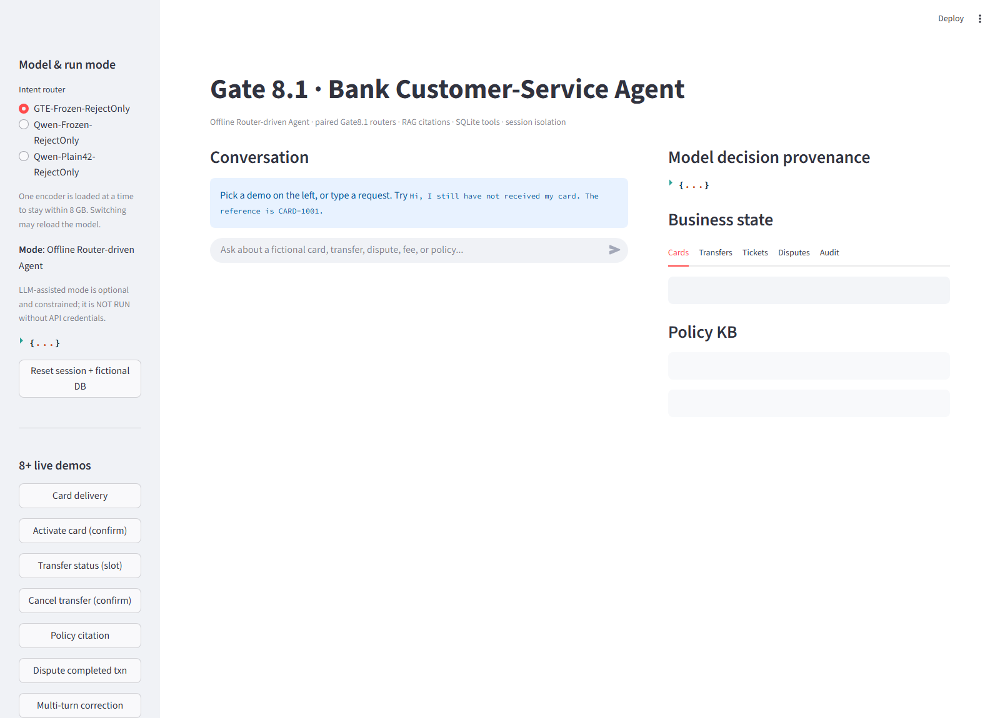
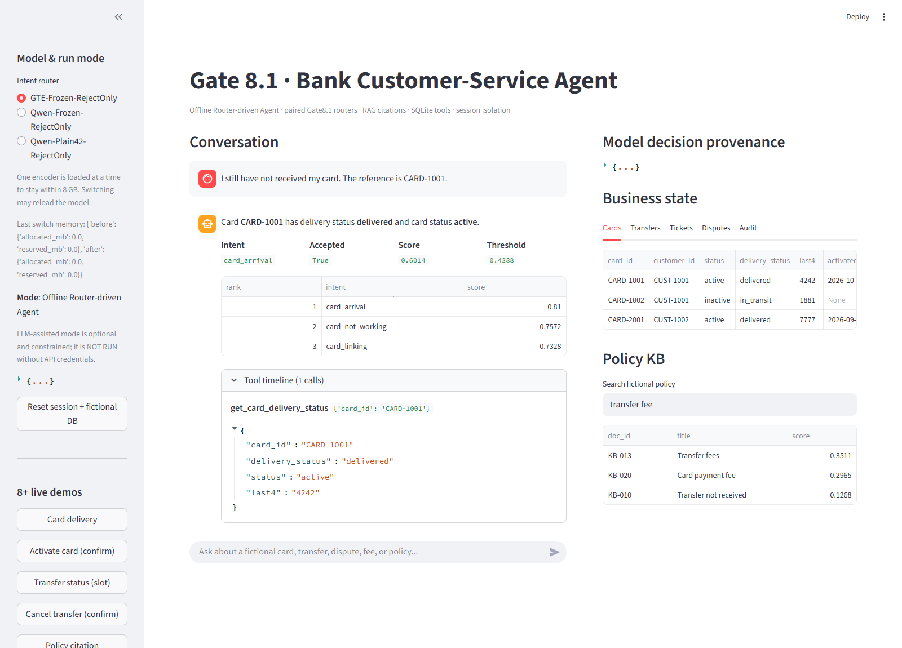
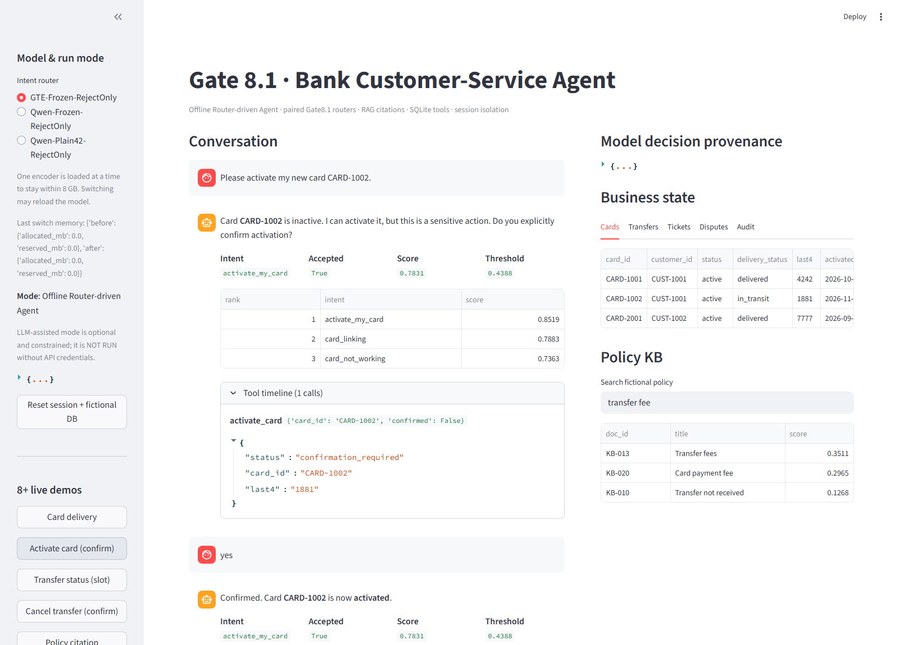
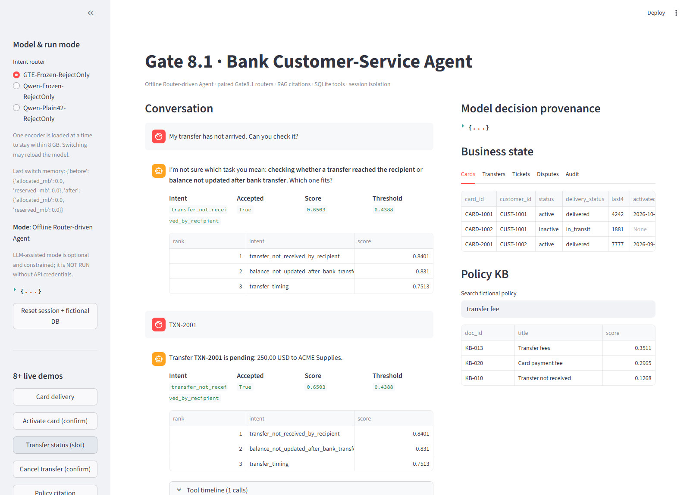
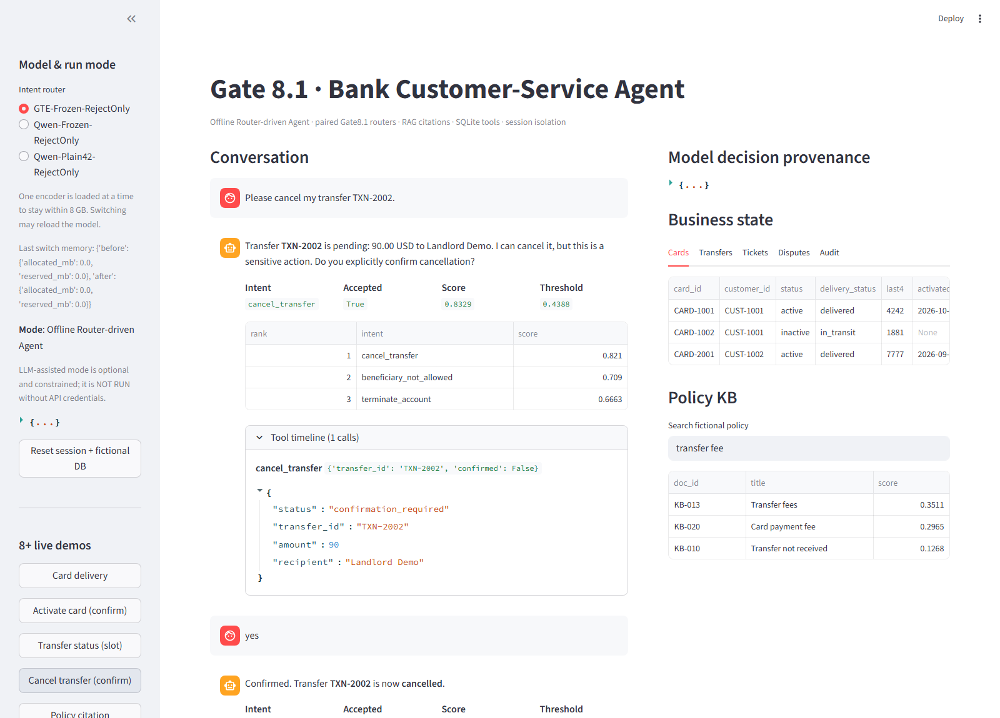
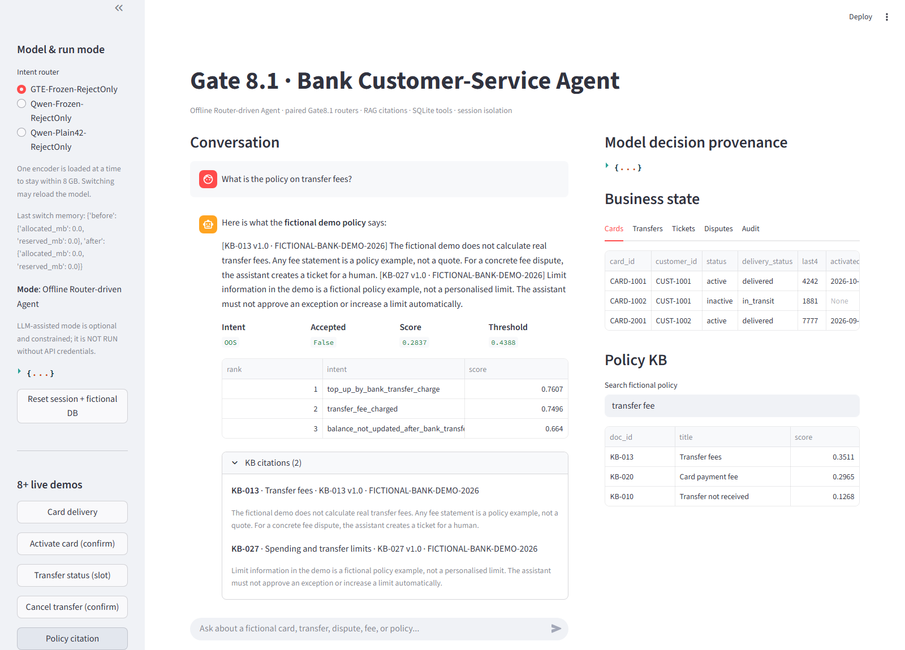
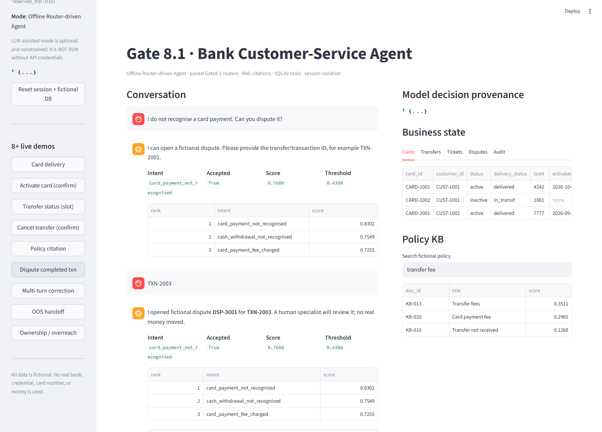
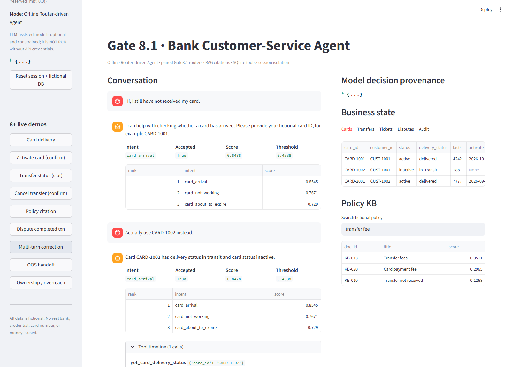
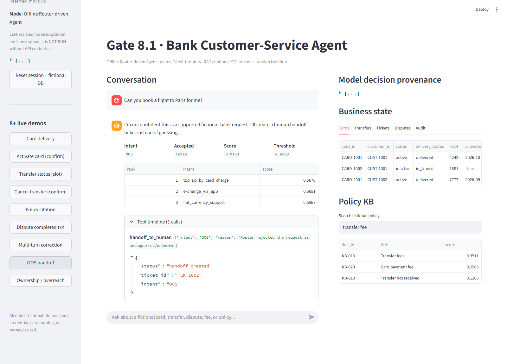
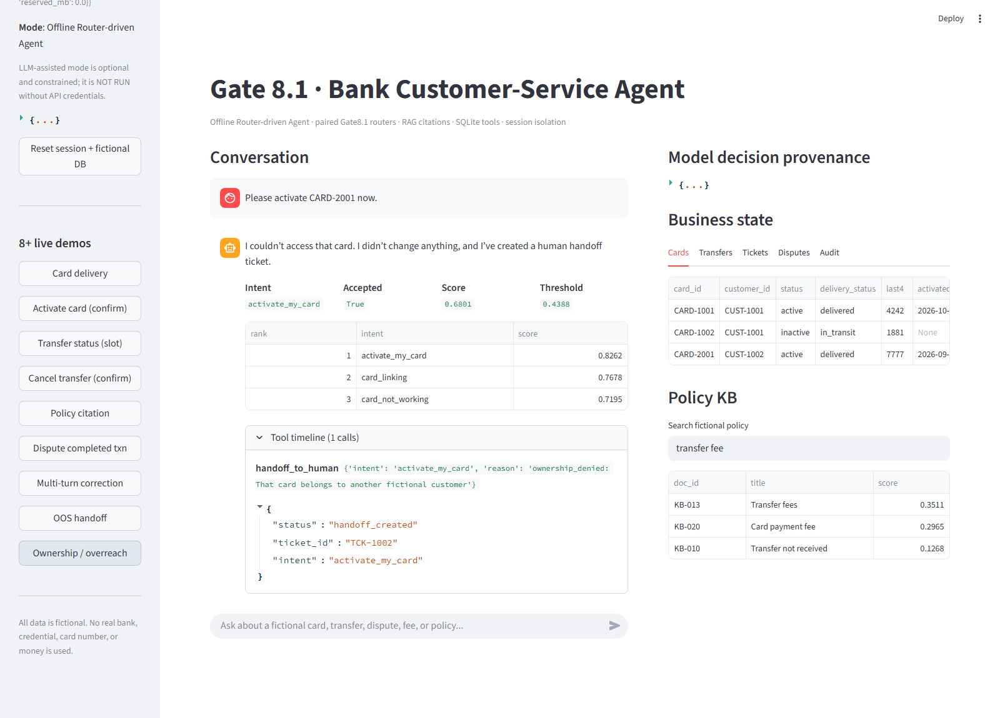

# Gate 8.1 真实界面截图画廊

全部来自 `app_gate8.py` 的真实运行（GTE-Frozen-RejectOnly，阈值 0.4388），
不是 mock、不是 CSV 预填。

## 1. 总览

## 2. 卡状态

## 3. 激活确认

## 4. 转账状态 / 槽位补全

## 5. 取消转账确认

## 6. 政策 RAG 引用

## 7. 争议 / dispute

## 8. 多轮纠正

## 9. OOS 转人工

## 10. 越权拒绝

## 说明

- 截图是实际 Streamlit 页面；
- 左侧显示模型/阈值来源；
- 中间显示 intent、accepted、score、threshold、Top-3、工具时间线；
- 右侧显示 SQLite 业务状态与 KB。
- 页面数据全部为虚构 demo 数据。
